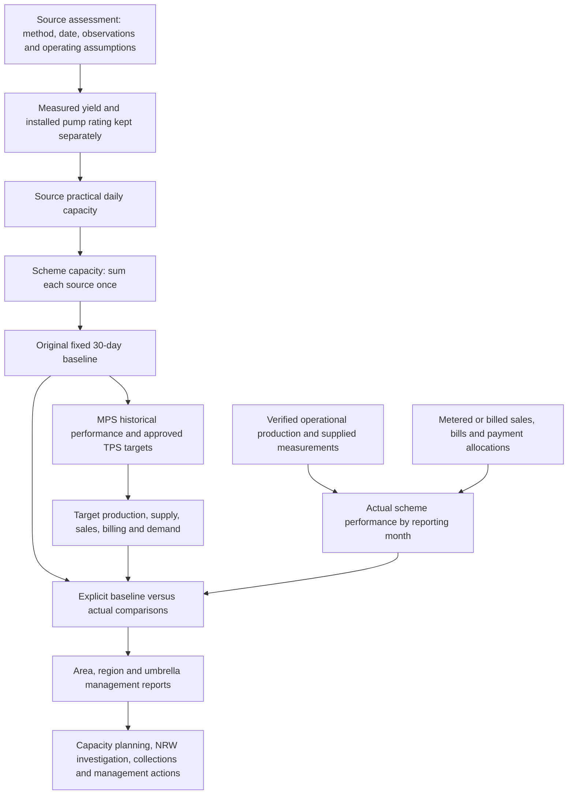

# SWUWS engineering basis and preservation review

Review date: 30 October 2026. Repository HEAD: `51d75cc1e1be87e02a7773a52a631751f30c9a53`. Status: findings and proposed remediation for approval. No application source, database records, migrations or workbook contents were changed. No commit, push, merge or deployment was performed.

## Conclusion

SWUWS retains the Production workspace, source configuration, verified production records, Intelligence, Decision Support, management actions, NRW indicators and Board Pack exporter. Its present calculations do **not fully preserve the workbook's engineering and management methodology**. The main gaps are baseline retention, the distinction between installed and measured pump capacity, source assessment provenance, original utilisation classifications, the complete MPS/TPS target chain, and reproducible historical reporting.

The verified daily log is a useful operational dataset. It cannot replace the original source-assessment baseline or historical target model. Preserve the verified workflow and add an explicit, traceable relationship to those baselines. Do not roll back verification safeguards to restore old totals.

The workbook itself contains inconsistencies. Preserve the original evidence, then record any approved interpretation or correction separately. In particular, do not automatically replace its 30-day assumptions, change its fixed 5%/25% target allowances, or derive target sales from the TPS NRW column without a business decision.

## Evidence and verification boundary

- Primary source: `C:/Users/MJ/Downloads/global target (1).xlsx`, SHA-256 `4965cef7c3c02428c8cf6a3af465c68ff2f3ccd56978182af2cbb44eccf6e622`.
- The existing parser's default `C:/Users/MJ/Downloads/global target.xlsx` is present and has the identical SHA-256. The filename difference does not explain discrepancies in this environment. Its machine-specific default is nevertheless a portability risk.
- All 18 worksheets were inspected, including blank `Sheet1`: 4,541 nonempty cells, 1,555 formulas, 106 external-link formulas and 19 saved error cells. Four of those errors are copied error values rather than formulas.
- `workbook-evidence.json` records all nonempty inputs, formulas, saved results, formats, merged ranges and external-link metadata. `formula-review-register.md` identifies every literal-bearing formula family, external formula and formula with explicit blank direct references. These are exhaustive mechanical inventories; flags are not automatically defects.
- Independently replayed all 1,449 non-external formulas using arithmetic and SUM, with saved values retained for external lookup results. No finite-value disagreements with saved caches, unsupported expressions or cycles were found. This checks arithmetic consistency, not engineering validity. See `arithmetic-check.json`.
- No native Excel recalculation or linked-workbook refresh was performed. External sources were identified from package metadata, not opened or verified.
- Current database **sources** below mean tables and fields read by the checked-in code. No business database connection was opened. Whether migrations 0069–0072 are applied, the actual baseline records retained, IAM assignments and live report totals remain unverified deployment facts.
- Existing focused tests: 5 suites, 47 tests passed. They emitted missing `DATABASE_URL` warnings; these unit/mocked suites are not production-database verification. No database integration tests or report-generation server actions were invoked.

## Workbook structure and reporting hierarchy

| Worksheet | Role | Nonempty cells | Formulas |
|---|---|---:|---:|
| METHODOLOGY | Field assessment procedures | 12 | 0 |
| KIGEZI | Source assessments for Kabale, Nyarushanje, Kisoro & Kanungu | 337 | 96 |
| RUJUMBURA | Source assessments for Rukungiri and Ntungamo | 259 | 77 |
| ISINGIRO | Source assessments for Isingiro Main and Rugaga | 158 | 47 |
| ANKOLE | Source assessments for Bushenyi, Ibanda and Rubirizi | 208 | 67 |
| GLOBAL SUMMERY | Historical production, sales, utilisation, production-based NRW and interpretation bands | 1,029 | 534 |
| TARGETS GOLBAL | MPS/TPS benchmarks, target supply/sales/billing and arrears demand | 1,162 | 460 |
| Sheet1 | Blank | 0 | 0 |
| KABALE | Operational-area target view and selected totals | 160 | 40 |
| NYARUSHANJE | Operational-area target view | 145 | 27 |
| KISORO& KANUNGU | Operational-area target view | 177 | 32 |
| RUKUNGIRI | Operational-area target view | 142 | 27 |
| NTUNGAMO | Operational-area target view | 174 | 32 |
| ` ISG.MAIN` | Operational-area target view; leading space in sheet name | 145 | 27 |
| RUGAGA | Operational-area target view and totals | 124 | 32 |
| BUSHENYI | Operational-area target view | 77 | 11 |
| IBANDA | Operational-area target view and totals | 121 | 29 |
| RUBIRIZI | Operational-area target view | 111 | 17 |

The source-assessment hierarchy is four regional sheets → ten operational areas → 64 schemes → 92 source/technology rows. Multiple rows can belong to one scheme. Some source eyes have no repeated source name, so a simple nonblank-name import would omit them. Scheme numbering in source sheets is not a universal ID: for example Kanyinamigyera's scheme name is at ANKOLE!D10 while its number is at C11, and KIGEZI numbering has gaps. Use reviewed identities and row membership, not number alone.

The implementation hierarchy is `organization → cluster → branch → water_scheme → water_scheme_source`. The workbook's combined Kisoro & Kanungu area requires an approved crosswalk to the live branches. RUJUMBURA places Mayanga under Rukungiri and Itojo under Ntungamo. Do not move their baselines to another branch just because a current live record differs. Preserve the workbook hierarchy and its effective context alongside approved current mappings.

The regional assessments, global capacity values and area target views are largely **copied values**, not a chain of cross-sheet Excel formulas. There are no internal cross-sheet formulas in this workbook. Thus the intended business flow is reconstructed from labels, matching scheme identities and numerical reconciliation; it is not an automatically maintained dependency graph. Operational-area numeric copies agree with their corresponding global targets where both contain numeric values, within the review tolerance.

## Intended engineering and management data flow



The baseline branch remains immutable. Live observations update actuals and variances. New assessments create dated baseline versions; they do not overwrite the original assessment. Current-configuration/calendar capacity may be useful as an additional comparator, with its own name and effective period.

### Source assessment procedures

METHODOLOGY!C5:C8 specifies channeling all spring/gravity flow into a known-volume container, timing its fill and converting L/s to m³/h. For example KIGEZI!K2 `=I2/J2` is 15 L / 22.94 s = 0.653879686 L/s; L2 `=K2*3.6` = 2.353966870 m³/h; M2 `=L2*24` = 56.495204882 m³/day; N2 `=M2*30` = 1,694.856146469 m³ per benchmark month.

METHODOLOGY!C11:C13 describes pumped-system bulk-meter dial/stopwatch computations, confirmatory volumetric tests at washouts, average pumping hours and pump capacities. The source sheets use both measured flow and installed ratings. RUJUMBURA!L4 `=(3600*10*0.01)/J4` and L8/L9/L16 `=(3600*10*0.1)/Jr` encode dial increments/counts directly. These imply timed volumes of 0.1 m³ and 1 m³ respectively; the meter calibration/unit assumption needs confirmation. It is not interchangeable with a bucket measurement merely because both yield m³/h.

Mixed-source scheme capacity must include each source with its own operating hours. KIGEZI!M3 `=(L3*G3)+(L4*G4)` combines Katuna's pump at 14 h/day with gravity at 24 h/day. RUJUMBURA!M18 similarly combines two Kahaama pumps with different regimes. KIGEZI!L5 already combines two Rwene yields, whereas M7 combines Kitojo's two hourly values. Importing these scheme aggregates as separate source yields would double-count sources.

### Historical production and NRW

GLOBAL SUMMERY!G:I holds July/August/September production; M:O holds the corresponding sales volumes. All scheme September inputs I/O are blank. In row 3, J3 `=I3+H3+G3` totals production; K3 `=J3/60` assumes two 30-day months; L3 `=K3/E3` gives utilisation. Q3 `=(G3-M3)/G3`, R3 `=(H3-N3)/H3` and S3 `=(J3-P3)/J3` are production-based NRW indicators. Percent cells store fractions, not 0–100 values.

The saved umbrella totals are production 205,261.6 m³ in July and 245,640.1 m³ in August; sales 109,592 and 95,183 m³. GLOBAL SUMMERY!S71 is 54.58544512% production-to-sales NRW over the combined period. G72/H72 calculate monthly utilisation against F71's 406,230.351999 m³ 30-day capacity: 50.52837608% and 60.46817989%. These are ratios of totals, not means of scheme percentages. Missing observations are not proof of zero production or sales.

### MPS and TPS targets

TARGETS GOLBAL!G4:H4, I4:J4, K4:L4 and O4:P4 distinguish MPS and TPS for utilisation, NRW, production and sales. Their functional meaning is historical/existing performance versus target performance. The workbook does not spell out the acronyms; confirm the exact business expansion before using it as a formal definition.

MPS utilisation generally copies the historical two-month ratio. TPS utilisation is stored as a number, with observed uplifts of 10 percentage points for 51 schemes, 0.5 points for six and 0.1 points for six. Rushaga has no TPS utilisation input. This is not a single universal target-setting formula. Kakamba's 0.1-point uplift despite an 81.57% baseline also cautions against inventing a uniform threshold rule. Most TPS NRW values are five percentage points below MPS, with Ryakarimira an exception (35% → 30%). No formula explains why each uplift was selected.

For row 5: L5 `=H5*F5` gives target production, M5 `=L5-(5%*L5)` gives target supply, P5 `=M5-(0.25*M5)` gives target sales, Q5 `=P5*U5` gives billing target, R5 obtains external arrears, and S5 `=R5+Q5` gives total demand. Thus the sales chain implies 28.75% production-to-sales loss: `1 - 0.95*0.75`. J5's TPS NRW of 30% is not used. P77 confirms 28.75% globally. M77 confirms a separate 5% production-to-supply allowance.

MPS production K generally copies July, while MPS sales O copies August. Ryakarimira K5 is an unexplained 1,500 m³ versus historical July 810. Its MPS NRW I5 is 35% versus historical aggregate 8.245614%. These are original exceptions, not permission to change actuals. TARGETS GOLBAL!T contains no scheme-level collection-efficiency inputs; N contains no scheme-level mains-extension inputs. Totals of blanks equal zero but do not establish targets or observed performance.

## Calculation comparison

Each row below is paired with the correction/test/impact row bearing the same ID. Paths identify checked-in implementations; database contents have not been asserted.

| ID | Original evidence and meaning/unit | Current implementation and database source | Verified discrepancy and status |
|---|---|---|---|
| C01 | METHODOLOGY!C5:C8; KIGEZI!K2/L2/M2: bucket L ÷ s → L/s × 3.6 → m³/h × h/day | `lib/production/service.ts:173–190`, `schemas.ts:39–50`; `water_scheme_source.containerVolumeLitres`, `averageFillTimeSeconds`, `productionCapacityLSec`, `currentCapacityM3Day` | Arithmetic preserved for new bucket assessments. No first-class assessment date, raw repeat trials, assessor evidence or original-sheet/cell identity. Current-row model is not an immutable assessment register. **Preserved arithmetic; provenance absent.** |
| C02 | METHODOLOGY!C11:C13; RUJUMBURA!L4/L8/L9/L16, ISINGIRO!L15: bulk-meter dial timing → m³/h | `service.ts:181`; `sourceSchema.capacityMethod` permits only unknown, measured_hourly and bucket_test | No explicit dial count, dial-volume calibration, timed meter readings or washout confirmation method. `measured_hourly` reads/writes the field named `installedPumpCapacityM3Hr`. Installed rating and measured flow share one value. **Modified/absent.** |
| C03 | KIGEZI!H31=21 m³/h installed, L31=16.4 m³/h measured, M31=G31*H31=105 m³/day; KIGEZI!M3, RUJUMBURA!M18: mixed sources | `service.ts:181–186`, `reporting.ts:40–44`; `water_scheme_source` rows grouped by scheme | Summation can preserve mixed-source capacity if correctly populated. It cannot retain both a measured hourly yield and installed rating independently under measured_hourly. Imported source versus scheme totals have no explicit role marker. **Partly preserved; double-counting and rating conflation risks.** |
| C04 | Source N columns `=Mr*30`; GLOBAL SUMMERY!F3; fixed 30-day engineering benchmark | `reporting.ts:62`; `service.ts:186`; DB current source daily capacities and confirmation metadata | Reports no longer use stored `practicalCapacityM3Month`; they sum active confirmed daily capacities × calendar days. Saving a source sets its monthly capacity to NULL. Historical periods use today's active configuration. **Benchmark changed; historical baseline at risk.** |
| C05 | GLOBAL SUMMERY!G:I, J3, K3=J3/60: actual m³ and historical daily mean | `reporting.ts:26–38`; `water_production_log.productionDate`, workflowVersion/status, produced/supplied | New official totals require workflowVersion=1 and verified, by production date month. Legacy totals are excluded, retained for explicit review. This is a sound verification distinction but not a replacement for historical workbook actuals. **Workflow improved; historical bridge absent.** |
| C06 | GLOBAL SUMMERY!L3; G72/H72; utilisation = matching production ÷ matching capacity; % | `performance-engine.ts:191–209,241–254`; `intelligence/engine.ts:167–170,232–241`; source capacities + verified logs | Formula ratio retained, period/baseline changed. Example July Ryakarimira: 810/1,694.856146=47.7917% at original 30-day baseline versus 46.2500% against 31 days of the same unrounded daily capacity. Current month-to-date numerator is also compared to full-month capacity. **Modified denominator.** |
| C07 | GLOBAL SUMMERY!D79:E83 and TARGETS GOLBAL!D87:E91: <50 underused; 50–75 healthy; 75–85 optimal; 85–95 stressed; >95 critical | `performance-engine.ts:251–256`; `intelligence/capacity.ts:25–79`; `decision-support/attention-engine.ts` | Live matrix labels 75–95 healthy, <75 watch, >95 stressed; Intelligence emits stress only above 95. Original 85–95 stress band and >95 critical interpretation are lost. Workbook endpoint inclusivity needs a documented convention. **Modified decision policy.** |
| C08 | GLOBAL SUMMERY!Q3/R3/S3; Banyara R21=-0.1435%, Endiizi Q54=-13.1780%: raw production-to-sales NRW | `data-validation.ts`; `intelligence/nrw.ts:21`; verified production + `meter_reading.consumption` | Decision Support preserves negative raw loss and flags it. Intelligence clamps loss volume to zero before calculation, suppressing that anomaly. Missing sales become 0 in engines, potentially producing a false 100% loss. **Partly preserved; inconsistent anomaly treatment.** |
| C09 | TARGETS GOLBAL!G:H, I:J, K:L, O:P: original MPS and TPS pairs | `excel-reference.ts`; `intelligence/engine.ts:145–156,287–299`; `scheme_target` | Parser reads H/J TPS correctly, but marks the source as sample/reference. Schema has no complete MPS/TPS pair model. Intelligence selects only production and collection targets; NRW, utilisation, billing and arrears-recovery target fields are not evaluated. **Partial storage; much of target model unused/absent.** |
| C10 | TARGETS GOLBAL!L5=H5*F5, M5=L5*(1-5%), P5=M5*(1-25%): target production/supply/sales m³/month | `service.ts` records actual supplied separately; `performance-engine.ts` aggregates actual supplied; no equivalent target-chain builder | No implemented end-to-end target derivation or separate fixed allowance inputs. Actual supplied is not used by production-to-sales loss, which is appropriate to that specific metric, but the separate production-to-supply analysis is missing from these reports. **Target chain and supply-stage comparison absent.** |
| C11 | TARGETS GOLBAL!Q5=P5*U5: UGX/month, tariff UGX/m³; F73 in GLOBAL uses fixed 2118*capacity | `performance-engine.ts` bills from `billing_record.billAmount`, sales from `meter_reading`; `excel-fixture.ts:58–59` computes sold×reference tariff | Actual billing is correctly a separate commercial source, but the TPS billing forecast/variance and tariff provenance are not reconstructed. Historical tariff assumptions must not become current customer tariffs. `scheme_target.targetBillingUgx` exists but is not evaluated here. **Actual billing preserved; benchmark revenue chain absent.** |
| C12 | TARGETS GOLBAL!R5 external arrears UGX; S5=R5+Q5 total demand | Engines use `billing_record.arrears`, `billAmount`, `totalDue`; `reports.ts` calls sum(totalDue) cumulative live arrears | `totalDue` is outstanding total demand, including unpaid current bills; it is not necessarily arrears-only. Original dated external arrears differ from live remaining demand. **Meaning changed; report label misleading.** |
| C13 | TARGETS GOLBAL!T3 and empty T scheme cells: collection efficiency intended, no calculable original target | Both engines infer collections from arrears+billAmount-totalDue; `reports.ts` defines total cash/current bills; `excel-fixture.ts:174–178` hardcodes 85% globally | No workbook evidence supports an 85% actual/target. Engine cash is balance-derived, not independently summed dated receipts/payment allocations. Adjustments, credits, write-offs and cash timing require reconciliation. Intelligence passes all cash as cashToArrears. **Unverified financial inference; fixture fabrication.** |
| C14 | GLOBAL SUMMERY rows 3–69 contain 64 schemes; D77 and D79:D83 are explanatory legend labels | `excel-reference.ts:115–149`; `excel-benchmark.test.ts`; `scheme-matcher.ts` | Parser returns 70 records and calls six legend rows referenceSourceRowCount. They are not water sources. Operational totals filter these out, so a six-row production double-count is not established; metadata and test assertions are wrong. **Misclassification verified.** |
| C15 | Four regional source sheets and ten area target views: hierarchy-based reporting | `scheme-matcher.ts`; `app/actions/decision-support.ts:190+`; `decision_support_scheme_mapping`; hierarchy tables | Baseline mapping exists, but live performance engine never consumes approved reference mappings or workbook capacities/targets. Matcher unconditionally excludes Karukara even if a valid distinct scheme is later created; alias matching accepts a blank branch because substring checks match empty text. **Mapping not an engineering-baseline bridge.** |
| C16 | GLOBAL SUMMERY July/August comparators; TARGETS GOLBAL!P79/P81 improvement indicators | `intelligence/engine.ts` loads real previous month; live `performance-engine.ts:361` returns empty periodDeltas; `board-pack.ts` renders dataset deltas | Intelligence's former synthetic prior-month values were replaced by real records, which is an improvement. Decision Support/Board Pack live deltas remain absent. Target improvement forecasts are not reconstructed. **Partly preserved; management comparison incomplete.** |
| C17 | Field tests/periods and hierarchy underpin repeatable historical reports | `water_scheme_source` current rows + `audit_log`; `report_generation_history`; `performance-engine.ts` joins sales/bills through current `customer.waterSchemeId` | Source versions/audit before-after are useful but reports do not resolve effective-dated source configurations. Editing/archiving a source or moving a customer can change a rerun old-period result. Returned dataset scope is always organization despite filtered input; history records only a small KPI subset. **Historical reproducibility at risk.** |
| C18 | Complete population of a scheme's sources and actual observations, rather than existence of any entry | `reporting.ts:35,60`; `data-validation.ts`; report/dashboard/attention consumers | Distinct scheme-days can report 100% day coverage with only one of several sources logged. Global available uses any scheme; suppliedComplete ignores schemes without production. Financial rows are labelled VALID without financial coverage checks. Critical attention items can be emitted from incomplete matrices. **Completeness labels improved, conclusions still overconfident.** |
| C19 | Original measurements and benchmark values retain full stored precision | `schema/intelligence.ts` source daily/monthly/hourly values numeric(12,2), L/s numeric(12,4); `schemas.ts` inputs ≤2 decimals | Early rounding changes totals even before changing period basis. Example 56.495204882 m³/day becomes 56.50; ×30 becomes 1,695.00 instead of 1,694.856146. **Precision differs; preserve exact original evidence.** |
| C20 | Original workbook is engineering evidence and historical benchmark | `excel-reference.ts:33,49`; `excel-fixture.ts:66,161–181`; existing reference and report flows | Fixture invents full day coverage, supplied=produced, year=2026 and 85% global collection. September blanks become zero and can appear fully complete. Source external names suggest FY2025–26/June2026 context, but sheet month headings alone do not prove the production year. **Synthetic fixture assumptions must not be presented as workbook facts.** |

## Recommended corrections, regression tests and report impact

All items are proposals; none has been implemented. Preserve current entry points and verified-log workflow throughout.

| ID | Non-destructive correction proposed | Regression evidence needed | Expected report impact |
|---|---|---|---|
| C01 | Retain immutable original assessment records, raw observations, provenance and method; link a current configuration to its approved assessment | 15/22.94 → L/s → m³/h → daily; original remains unchanged after a new assessment | Traceable engineering basis in existing capacity reports |
| C02 | Separate installed rating from measured hourly yield; represent bulk-meter timing and confirmatory measurements without forcing them into bucket fields | Both dial formulas, their units and independent washout result; measured versus installed field separation | Explains practical versus installed capacity without erasing either |
| C03 | Model source membership and calculation role explicitly; preserve each source's regime and scheme aggregation | Katuna, Rwene, Kitojo, Kahaama and multi-source Buhunga fixtures; each source counted once | Correct scheme/area totals and source-level diagnosis |
| C04 | Keep original 30-day baseline; provide separately named calendar/current and effective-period capacity comparisons | Source edit/archive leaves old baseline and old-period report unchanged; 28/29/30/31-day variants | Original comparability restored; calendar capacity remains available |
| C05 | Keep legacy, original historical totals, provisional and verified actuals separate; reconcile historical observations with approved review, retaining before/after evidence | Legacy excluded from official verified totals; historical monthly records retained without being fabricated as daily records; review independence | Totals may initially remain unavailable; reconciliation explains changes without deleting history |
| C06 | Declare numerator dates and selected capacity basis; compare full months or matching elapsed-day capacity; never relabel one basis as another | July Ryakarimira and two-month /60 example; month-to-date vs full month; weighted umbrella ratio | Utilisation becomes interpretable and comparable |
| C07 | Use the approved workbook interpretation table consistently in Intelligence, matrix, attention and reports; document exact boundary ownership | Values just below/at/above 50,75,85,95; no overlap/gap | 85–95 schemes become stressed; >95 become critical under workbook policy |
| C08 | Share raw-loss validation; retain negatives and missing-sales availability, with distinct data-quality investigation | Produced=100/sold=110; produced=0/sold>0; no sales vs measured zero; incomplete sources; aggregate netting of scheme anomalies | Honest NRW anomaly detection across both modules |
| C09 | Retain original MPS/TPS values with approval/version and effective period; select all supported approved target dimensions | Exact 51/6/6 uplift groups and Rushaga missing; genuine zero vs blank; J/H parsed as TPS; target rule by scheme/version | Original target comparisons return without inventing new targets |
| C10 | Preserve fixed 5% and 25% allowances as explicit original assumptions; flag conflict with J-column TPS NRW; add approved variants only after resolution | Row5 target production 1,024.485614647, supply 973.261333915, sales 729.946000436; aggregate 5% and 28.75%; changing J alone must not alter original-as-written P | Supply losses, target sales and target NRW become distinguishable |
| C11 | Show actual billing beside dated target billing; retain tariff assumption source and unit separately from current billing tariffs | P5×2118=1,546,025.628923 UGX before presentation rounding; 2990 tariff examples; actual bills reconcile independently | Revenue variance is restored without rewriting bills or tariffs |
| C12 | Label opening arrears, outstanding current bills and total remaining demand separately; retain external arrears date/cache/source | Arrears100/current50/payment20 → opening arrears100, remaining arrears80, total due130; late adjustments | Removes misleading arrears amounts and improves debt actions |
| C13 | Reconcile balance-derived collections to authorised payment/allocation sources and cutoff; preserve current/arrears split; remove unsupported fixture actuals | Arrears payments, current payments, overpayments, credits/write-offs, reversals, cancelled bills and late receipts; current cash cannot count as arrears recovery | Collection/arrears recovery become defensible; values may differ from inferred totals |
| C14 | Classify legend rows as methodology; preserve the 64 schemes and separately extract the 92 source/technology rows | No legend row can become a scheme or source; continuation-source eyes retained; no NaN numeric values | Correct metadata and baseline coverage; no expected change to already-filtered operational sums |
| C15 | Use reviewed durable identity mappings plus complete hierarchy evidence; fail closed on blank hierarchy; distinguish suggested from approved mapping | Karukara remains distinct from Karenga, can later link only by valid approval; Mayanga/Itojo hierarchy conflicts; duplicate names and combined-area branches | Auditable baseline association and accurate operational-area rollups |
| C16 | Feed validated previous-period measures and approved target comparisons into existing Decision Support/Board Pack datasets | Two completed real months; missing/zero prior baseline; partial months not called comparable; no synthetic values | Populates meaningful 'what changed' and forecast-gap reporting |
| C17 | Effective-date source/target/hierarchy mappings and retain report input/version references plus cutoff; capture true scope | Old report replay after source/customer changes; branch/scheme filters and recorded report scope; mapping changes | Historical packs reproducible; organisational scope accurately recorded |
| C18 | Track expected source-days and financial coverage separately; gate management conclusions on matching completeness, while retaining visible provisional figures | Two-source scheme with one source missing every day; one of two schemes missing; financial records absent; reported zero distinguishable | Avoids false confidence and premature leak/capacity conclusions |
| C19 | Preserve exact raw workbook numbers and derivation, round for display/approved storage only | Fractional yields, summed mixed sources and month conversion reconciled within documented tolerances | Small numerical differences are explained, not silently accumulated |
| C20 | Treat original reference dataset as a versioned business baseline; keep any synthetic scenario explicitly separate and out of actual/report totals | September unavailable; no assumed 85%/100% coverage/year/supply; missing source file explicit | Reference reports cease presenting fabricated observations |

## Workbook defects and unresolved assumptions

These are defects or ambiguities in the original source, distinct from implementation regressions. Keep their original formulas/values and proposed corrections side by side.

| Evidence | Finding | Treatment proposed |
|---|---|---|
| ISINGIRO!M10 `=(L10*G10)+(K11*G11)` | Adds m³/h×hours and L/s×hours. The second term uses K11 rather than converted L11. Saved capacity 799.085714286 m³/day. Using L11 would give 888.228571429, +89.142857143 m³/day or +2,674.285714286 m³/30-day month | Verified dimensional/reference inconsistency. Do not silently correct Rugaga's original baseline, its copied summaries or targets. Submit a separate approved corrected assessment |
| KIGEZI!I9/J9/K9/L9 | 15/6.19 = 2.423263328 L/s, but stored K9=0.67 L/s and L9=2.42 m³/h. The three representations disagree materially | Verify original field notes and which value was authoritative for Noozi; preserve saved capacity 58.08 m³/day meanwhile |
| KIGEZI!J22:J26, J28:J29 | Fill times are back-calculated from stored yields using I/K | Do not call these independent stopwatch observations; retain derivation direction |
| KIGEZI!K6/K7/K8/K14:K16/K21 and selected L values | Some yields/rates are entered constants or rounded copies rather than formulas | Preserve original precision and method; do not automatically recompute all constants from adjacent fields |
| KIGEZI!H31 versus L31; RUJUMBURA!L11 and G11 | Rushaga uses installed 21 rather than measured 16.4 m³/h for capacity; Buhunga assumes 24 pump hours despite a source label mentioning solar | Distinguish engineering assumptions from observations and confirm operating regime rather than substituting a universal solar regime |
| RUJUMBURA!K4/K8/K9/K28; ISINGIRO!K15 | Empty container fields cause zero bucket yields, while capacity is derived through a different method | These zeros are not evidence of zero source yield; preserve method-specific applicability |
| ISINGIRO!K9 | 14.4 is entered in L/s column and installed/hourly capacity is also 14.4 m³/h | Potential unit-entry error; downstream L9 uses I9, so correcting K9 is not automatically a capacity change |
| ANKOLE!K16/K17/K20/K21 | Division by blank fill times gives four saved #DIV/0! errors; daily capacities use installed ratings instead | Mark bucket test unavailable/not applicable; do not infer failed pump capacity from an unused calculation |
| ANKOLE!K19/G19/L19/M19/N19 | Akashayi second borehole lacks yield and operating hours; formulas produce zero | Incomplete assessment, not a proven zero-capacity source; do not omit it from source coverage |
| GLOBAL SUMMERY!I3:I69/O3:O69 and K3:K69 | September input columns blank while totals include them; daily mean remains /60 | Preserve two-month baseline; adding September without changing approved period basis would distort daily utilisation |
| GLOBAL SUMMERY!Q24,Q25,R25,S25,Q26,R26,Q30,Q33,Q42,Q43,R43 | Eleven saved division errors; some sit in blank spacer rows and some in operational rows | Retain raw evidence, report missing denominator/period and exclude non-scheme rows from calculations |
| TARGETS GOLBAL!I27/J27; KISORO& KANUNGU!I13/J13 | Four copied #DIV/0! error values for Rushaga; H27 absent yet L27 calculates zero | Missing benchmark, not valid 0% TPS or zero target production |
| GLOBAL SUMMERY!R21,Q54,S54; TARGETS GOLBAL!J23/J56 | Negative historical losses and negative NRW targets (Banyara and Endiizi) are present | Preserve raw signed results and flag investigation. A blanket clamp would erase source evidence |
| TARGETS GOLBAL!J5/J6 versus P5/P6; P77 | Scheme-specific target NRW does not drive sales; fixed allowances imply 28.75% regardless of scheme | Business decision required: original-as-written chain versus an approved revised target methodology. Keep both distinguishable |
| TARGETS GOLBAL!I5/K5 | Ryakarimira MPS NRW=35% and production=1500 differ from historic aggregate NRW=8.245614% and July production=810 | Record as explicit original exceptions; global MPS production total is 690 m³ above historical July for this reason |
| RUGAGA!G10:J10 | SUM of utilisation/NRW percentage columns gives totals above 100% (e.g. G10=420.5553%) | Preserve original cell; use ratio-of-matching-totals for approved aggregate performance, not sums of percentages |
| TARGETS GOLBAL!T74; KABALE!T12; IBANDA!T10 | SUM of blank collection targets returns 0; summing percentages would also be invalid once populated | Missing target remains unavailable; collection efficiency aggregates from appropriate monetary components |
| TARGETS GOLBAL!N74 and area N totals | Zero totals result from no scheme extension inputs, unit km/year | Do not report measured/approved zero extension targets |
| GLOBAL SUMMERY!F73 `=2118*F71` | Uses one fixed tariff against full capacity, unlike scheme tariffs and target realised volumes | Label capacity-valued benchmark, not actual billing or complete TPS revenue |
| TARGETS GOLBAL!P79 `=(Q74-287393820)/Q74`; P81 `=(L74-245640.1)/L74` | Fixed historical billing/production comparators, divided by target/new amount. Saved 34.14971465% and 5.23207329% are not conventional old-base growth rates | Preserve exact original definitions; if old-base growth is approved, add separately named results. The billing comparator's source is unresolved |
| Regional versus GLOBAL SUMMERY capacity copies | Bikurungu N5=9041.860465 versus F28=9042; Katabushera M6=162.865498/N6=4885.964943 versus E29=162.9/F29=4886; Burombe M9=259.459459/N9=7783.783784 versus E30=259.5/F30=7784 | Identified rounding differences. Preserve both source and reporting precision and their provenance |

External arrears formulas use both `[1]Arrears` lookup keys and `[2]Sheet1!$1:$1048576` column 7 exact-match lookup ranges. Package relationships identify `Commercial  Reports FY 2025-2026_REMIS-UPMIS.xlsx` and `FINAL BILLING REPORT JUNE 2026 (1).xlsx`, at old machine paths. There are 53 such formulas in TARGETS GOLBAL and 53 repeated in operational-area sheets. Saved arrears are historical caches, not verified current balances. Missing external files, lookup-key mismatches, duplicate keys and column meaning cannot be resolved from the attached workbook alone. All 106 locations are enumerated in the formula register.

The formula register also identifies 659 literal-bearing formulas and 195 formulas referring explicitly to blank cells. Literal groups include valid conversion factors 3.6/3600, 24-hour assumptions, 30/60-day periods, dial increments, 5%/25% allowances, fixed tariffs/comparators and scheme-number increments. Do not treat every literal as an error, or every blank within a SUM as missing operational evidence. Resolve flags in the context of method, row role and reporting period.

## Recent commits and migrations 0069–0072

| Change | Preserved/improved | Changed or remaining risk |
|---|---|---|
| `2dcfca5` verified production workflow | Production workspace and both dashboards retained; shared reporting service; real calendar dates; real prior production replaces invented 90%/92% comparators; availability labels and scoped verification | Engines switch from stored practical monthly capacity to active confirmed source daily capacity × calendar days, and from period-linked logs to verified date-based records. This is the main baseline/reporting semantic change |
| 0069 production integrity | Existing measurements retained as workflowVersion 0; no auto-verification; source/day uniqueness, source-scheme FK, restricted deletes, values/state checks, version guards and immutable log identity | Legacy records cease contributing to official totals until reviewed; source configuration remains mutable current state. Default method unknown and confirmation requirements can make old benchmark capacity unavailable. Existing incompatible rows can stop migration preflight; deployment outcome was not checked |
| 0070 permissions | Adds explicit production view/create/verify/source-manage permission definitions | Does not grant or scope them. A migration alone does not establish that operators/verifiers retain access |
| `51d75cc`, 0071 independence | Legacy reviewer cannot verify own reviewed record; preflight stops if conflicting already-verified records exist | Can block rollout pending authorised reconciliation. Does not restore assessment baselines or missing targets |
| 0072 universal guard | Database INSERT/UPDATE trigger rejects self-approval and verified rows without verifier, including legacy workflow version | No engineering formula changes. Trigger is prospective and does not itself validate every already-existing verified legacy row. Keep safeguard; verify rollout separately |
| Report and Board Pack changes | Four report types and 14-slide exporter remain; availability labels added | No full original target model; live deltas empty; Board Pack TPS slide states targets are configured without displaying actual approved target values/variances; source effective dates absent |

No evidence supports replacing SWUWS architecture with WATOPS. The prior local WATOPS audit describes potential complementary workflows such as energy, water quality, assets and work orders. Those observations establish no precedence over the attached workbook and were not independently revalidated in this review. No new REA/WATOPS work was necessary to establish the discrepancies above.

## Preservation-first remediation sequence for approval

1. **Freeze and identify evidence.** Register the workbook hash, original sheet/cell identities, exact raw values, errors, assumptions and reporting-period uncertainties as the original baseline. Preserve all 64 schemes and source memberships. Keep assessment records, historical actuals, management targets and new daily observations as distinct data meanings. Do not import legend rows as sources.
2. **Approve the methodology decisions.** Resolve MPS/TPS terminology and historical year/period, the /30 and /60 baseline convention, utilisation band boundaries, installed-versus-measured pump selection, fixed supply/sales allowances versus scheme TPS NRW, growth denominator definitions, and the documented cell inconsistencies. Obtain linked arrears evidence before calling cached balances verified. A correction creates an approved revision; the original remains retrievable.
3. **Specify baseline retention before implementation.** Review a minimal effective-dated assessment/target/provenance contract that can retain original and corrected versions, source membership, current configuration and report cutoff. Existing schema fields/audit history are not enough to guarantee reproducible old-period calculations. Any schema proposal is a later, separately reviewed design artifact; no migration is proposed for execution now.
4. **Repair shared calculations behind existing interfaces.** Implement selected-baseline capacity, matching-period utilisation, shared signed-loss validation, complete target comparisons, financial availability and defensible collections/arrears labels. Preserve verified/provisional/legacy distinctions and independent verification. Use current configuration only when explicitly selected and labelled.
5. **Reconnect existing management outputs.** Extend the present Production workspace, Intelligence, Decision Support, NRW reports and Board Pack with original/approved benchmark, actual, variance, basis, effective date and completeness. Use existing hierarchy and approved mappings for area/region rollups. Preserve report entry points and management actions. Add no replacement production UI.
6. **Verify on disposable fixtures and reconcile reports.** Add the C01–C20 regression evidence, plus true PostgreSQL constraint/transition checks against an expressly authorised disposable database. Compare before/after outputs for all 64 schemes, ten operational areas and umbrella totals. Explain every difference as data eligibility, selected baseline, approved methodology revision, rounding or corrected defect. Do not overwrite historical reports.
7. **Present a concrete implementation diff and report comparison for subsequent approval.** Only after the design/calculation plan is approved should source changes be prepared. Any migration, database backfill or deployment needs its own reviewed scope and evidence. Preserve rollback by retaining baseline versions, prior report metadata and original observations; never remove safety triggers to make totals match.

Acceptance criteria: original-as-written benchmark results are reproducible; corrected assumptions are explicit revisions; live data updates actuals only; historical reports survive later source/target/customer changes; negative and unavailable data stay visible; all existing workspaces/report endpoints and review controls remain; no WATOPS-derived policy replaces approved SWUWS methodology.

## Tests performed and remaining verification

Executed existing tests only:

```
npm test -- lib/production/reporting.test.ts lib/production/schemas.test.ts lib/decision-support/excel-benchmark.test.ts lib/decision-support/reports.test.ts lib/decision-support/scheme-approval.test.ts
```

Result: 47 passed across five files. The initial sandbox run could not resolve the config because of directory permissions; the authorised rerun passed. These tests cover calendar helpers, schemas, existing workbook parser expectations, mapping action mocks and report package/availability behavior. They do not independently verify bulk-meter methods, original source-sheet membership, unchanged historical baselines or the complete live data-fetch pipeline. In particular, a passing assertion that six legend rows are “reference source rows” preserves a misclassification rather than establishing workbook fidelity.

The remaining approval decisions are methodological, not permission to modify records now. Database applied-state inspection and an engineering/business review of the unresolved assumptions should precede implementation. No source or database modification is included in this deliverable.
